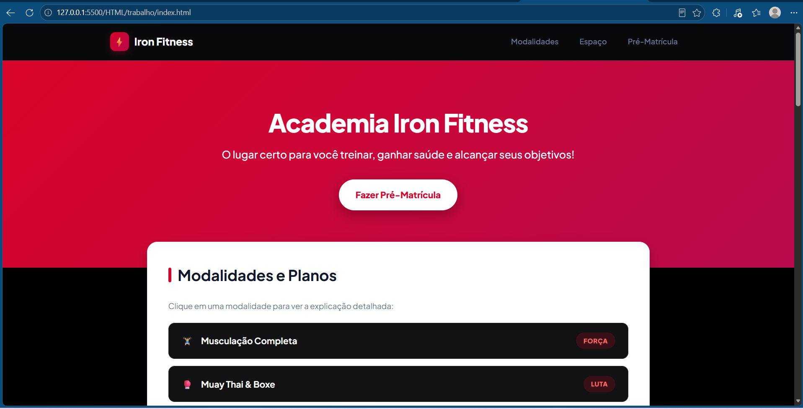
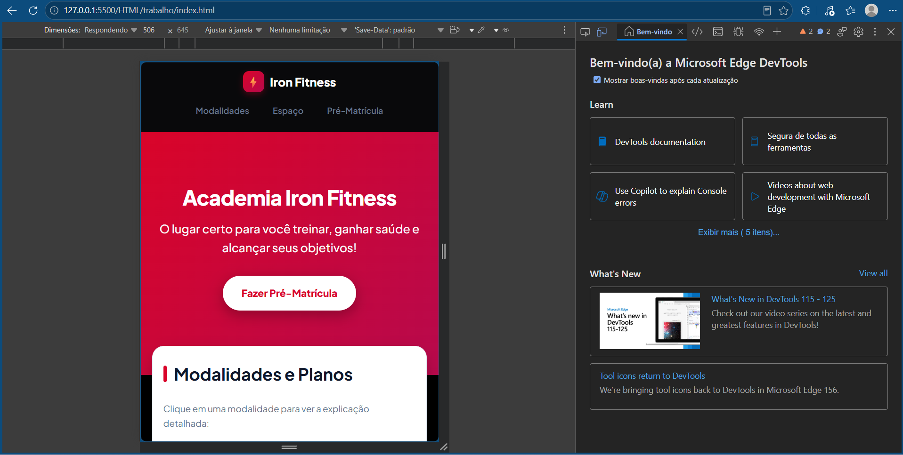

# Projeto Integrador - Academia Iron Fitness

## 1. Descrição do Projeto
A **Academia Iron Fitness** é uma aplicação web interativa desenvolvida para atender ao público fitness, oferecendo informações detalhadas sobre modalidades, horários e valores de planos. O projeto tem como objetivo proporcionar uma experiência moderna e intuitiva aos usuários, contando com um formulário de pré-matrícula integrado com validações e triagem de saúde em tempo real.

## 2. Tecnologias Utilizadas
* **HTML5** (Semântica avançada, estruturação de formulários, tabelas e mídias)
* **CSS3** (Variáveis personalizadas no `:root`, Flexbox, Grid Layout e design responsivo)
* **JavaScript Puro (Vanilla)** (Manipulação de DOM, arrays de objetos, estruturas condicionais, laços de repetição, funções e eventos)

## 3. Capturas de Tela
### Versão Desktop


### Versão Celular (Responsivo)


## 4. Estrutura de Pastas
```text
trabalho/
├── index.html
├── reset.css
├── style.css
├── script.js
└── images/
    ├── desktop.png
    └── celular.png
